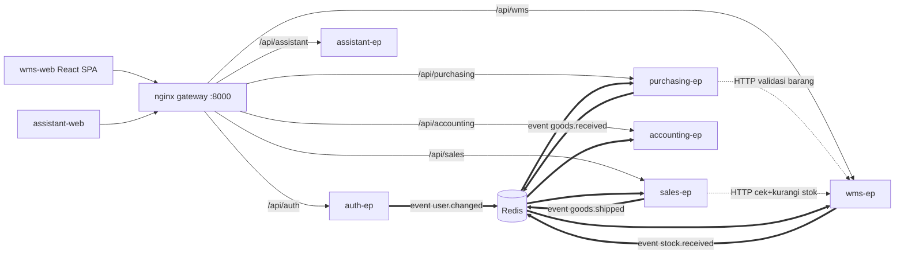

# Sun Logistic: Arsitektur Microservices

Dokumen rancangan. Tujuan: menunjukkan pemahaman **microservices, React, dan Docker lokal**
lewat satu sistem yang berjalan penuh dengan `docker compose up`.
Batas waktu: pertengahan Desember 2026. Dokumen ini hidup: ubah saat keputusan berubah.

## 1. Tujuan dan non-tujuan

**Tujuan**
- Tiap service punya database sendiri dan bisa di-deploy sendiri.
- Komunikasi sinkron (HTTP) dan asinkron (Redis queue) dipakai di tempat yang tepat, dan alasannya bisa dijelaskan.
- Satu perintah menjalankan semuanya, termasuk migrate dan seed.
- Kegagalan satu service tidak menjatuhkan service lain, dan itu bisa didemokan.

**Non-tujuan (sengaja tidak dikerjakan)**
- Kubernetes, service mesh, tracing terdistribusi, RabbitMQ/Kafka (bonus jika waktu sisa).
- Pajak, multi-mata-uang, HPP/costing, retur, pembayaran parsial (daftar "nanti" di bagian 10).
- Micro-frontend. Frontend tetap satu SPA (`wms-web`) dengan menu per domain.

## 2. Gambaran besar



Garis putus-putus = HTTP sinkron. Garis tebal = event lewat Redis.

## 3. Service dan kepemilikan data

Aturan utama: **satu tabel dimiliki tepat satu service**. Service lain tidak membaca DB-nya dan tidak ada foreign key lintas DB.

| Service | Database | Memiliki | Port dev |
|---|---|---|---|
| `auth-ep` | `auth_ep` | users, roles, permissions, password, token | 8001 |
| `wms-ep` (sudah ada) | `wms_ep` | cabang, gudang, rak, barang, satuan, stok, pergerakan, penyesuaian, pemindahan | 8002 |
| `purchasing-ep` | `purchasing_ep` | suppliers, purchase_orders, purchase_order_items, goods_receipts | 8003 |
| `sales-ep` | `sales_ep` | customers, sales_orders, sales_order_items, shipments | 8004 |
| `accounting-ep` | `accounting_ep` | accounts (COA), journals, journal_lines | 8005 |
| `assistant-ep` (sudah ada) | `assistant_ep` | percakapan, sites | 8006 |

Port dev: gateway 8000, lalu service berurutan sesuai prioritas (auth 8001 ... assistant 8006).

Satu container MySQL dengan **database dan user MySQL terpisah per service** (user hanya punya hak ke DB-nya sendiri).
Secara logis terpisah dan terpaksa lewat API; secara fisik di production akan menjadi instance terpisah.

### Konsekuensi pemisahan data (dan solusinya)

| Masalah | Solusi |
|---|---|
| `created_by_id` di semua tabel WMS selama ini FK ke `users` | Kolom tetap ada tapi **tanpa FK** (hanya angka id). |
| Daftar WMS menampilkan nama pengguna (custody, dsb.) | Tiap service menyimpan tabel **read-model** `users` (id, name, role) yang diisi dari event `user.changed`. Tanpa password. |
| Purchasing/Sales butuh data barang | Simpan `product_id` + **snapshot** (sku, nama, harga) saat pesanan dibuat. Validasi keberadaan barang lewat HTTP ke WMS. |
| Transaksi lintas service tidak bisa satu `DB::transaction` | Alur dirancang sebagai **saga** sederhana (bagian 6) dengan status dan kompensasi. |

## 4. Auth dan keamanan

- `auth-ep` menerbitkan **JWT RS256** (access token 60 menit). Private key hanya di auth; service lain memegang **public key** dan memverifikasi token **secara lokal**, tanpa memanggil auth di setiap request.
- Klaim token: `sub` (user id), `name`, `roles` (daftar nama role), `permissions` (daftar gabungan tanpa duplikat), `exp`. Umur token **60 menit**; perubahan izin berlaku saat token berikutnya terbit.
- **RBAC:** satu user banyak role, satu role banyak permission. Izin efektif = union izin semua role user. Izin ditambahkan ke **role**, bukan ke user. Kebutuhan khusus satu user dijawab dengan membuat role baru. Izin langsung per user (`user_permissions`, hanya grant, tanpa deny) baru dipertimbangkan bila role sekali pakai menumpuk.
- **Penamaan permission:** `resource.action`, mis. `product.read`, `product.create`, `handover.complete`. Aksi non-CRUD diberi nama sendiri.
- **Katalog permission dimiliki auth** (di-seed, dikelompokkan per service). Service lain hanya memeriksa string (`can('product.create')`). Role `admin` diberi semua permission secara eksplisit, tanpa bypass tersembunyi di kode.
- Pembatasan data (mis. operator hanya cabang tertentu) = konsep *scope*, bukan permission; di luar cakupan sekarang.
- **Status migrasi WMS (selesai):** `wms-ep` memverifikasi JWT dengan public key (tanpa Sanctum), tiap endpoint memakai `#[Authorize('resource.action')]`. Tabel `users` di WMS kini read-model (id, name, active) tanpa password; baris dibuat/diperbarui otomatis dari token pada request pertama (sementara, sampai event `user.changed` ada). Semua FK ke `users` dilepas. `GET auth/me` di WMS tetap ada (mengembalikan user, `lang` WMS, dan `permissions`). Permission `handover.read_all` (hanya admin dan supervisor) menentukan apakah dashboard menampilkan semua pemindahan atau hanya milik sendiri.
- **Status migrasi assistant (selesai):** `assistant-ep` memverifikasi JWT sendiri (public key), tidak lagi memanggil `auth/me` milik site. Tiap tool menyebut permission yang dibutuhkan, dan daftar tool yang dilihat LLM disaring sesuai permission di token (tool tanpa izin tidak pernah ditawarkan). Tiap aksi tetap memakai token user itu sendiri, jadi wms-ep tetap menjadi pemeriksa terakhir. Kolom `identity` di tabel `sites` dihapus.
- Frontend membaca permission dari token / `/auth/me` untuk menyembunyikan menu dan tombol; pemeriksaan sebenarnya tetap di backend.
- Pustaka: `firebase/php-jwt` (kecil, cukup). Satu middleware kecil yang sama disalin ke tiap service.
- Trade-off yang dicatat: token tidak bisa dicabut sebelum kedaluwarsa. Mitigasi: umur pendek. Refresh token / denylist = nanti.
- Service-ke-service (mis. sales memanggil WMS): meneruskan **token pengguna yang sama** (bukan service account) agar jejak `created_by_id` tetap benar.
- Sanctum dilepas dari `wms-ep`; `assistant-ep` memverifikasi identitas lewat middleware JWT yang sama (config `identity` di tabel `sites` diperbarui).

## 5. Gateway (nginx)

Satu pintu masuk `http://localhost:8000`; frontend hanya mengenal satu base URL. Routing berdasar prefix, prefix dibuang sebelum diteruskan, jadi route di tiap service tidak berubah.

```
/api/auth/{login,logout,me} -> auth-ep /api/auth/*
/api/auth/{users,roles,permissions} -> auth-ep /api/* (prefix dibuang)
/api/wms/*         -> wms-ep
/api/purchasing/*  -> purchasing-ep
/api/sales/*       -> sales-ep
/api/accounting/*  -> accounting-ep
/api/assistant/*   -> assistant-ep   (SSE: proxy_buffering off)
/                  -> wms-web
```

Gateway hanya routing + `X-Request-Id` (CORS tetap ditangani Laravel di tiap service). Nama upstream di-resolve per request, jadi gateway tetap hidup saat satu service dimatikan (penting untuk skenario kegagalan). Tidak ada logika bisnis dan tidak ada verifikasi token di sini (tiap service tetap memeriksa sendiri).

## 6. Komunikasi: kapan sinkron, kapan asinkron

**Sinkron (HTTP) saat hasilnya dibutuhkan sekarang** dan bisa membatalkan operasi.
**Asinkron (event) saat pihak lain cukup "akhirnya konsisten"** dan pengirim tidak boleh gagal karena penerima mati.

| Alur | Mode | Alasan |
|---|---|---|
| Sales kirim barang -> kurangi stok WMS | Sinkron | Stok harus cukup *sekarang*; kalau kurang, pengiriman ditolak. |
| Purchasing terima barang -> tambah stok WMS | Asinkron (saga) | Penerimaan fisik sudah terjadi; WMS boleh telat, tapi harus akhirnya masuk. |
| Purchasing/Sales -> Accounting | Asinkron | Pembukuan tidak boleh menghambat transaksi; accounting boleh mati sementara. |
| Auth -> semua service (data user) | Asinkron | Read-model pengguna. |

### Event lewat Redis queue

- Pakai **Laravel queue (driver redis)**, satu queue bernama per penerima (`wms`, `accounting`, `purchasing`, `sales`).
- Pengirim memasukkan payload mentah berformat job lama Laravel (`{"job":"App\\Handlers\\X@handle","data":{...}}`) lewat `Queue::pushRaw`, sehingga **pengirim tidak butuh kelas milik penerima**. (Harus diverifikasi di spike hari pertama.)
- Envelope event (kontrak antar service):

```json
{
  "id": "uuid",
  "type": "goods.received",
  "occurred_at": "2026-12-01T10:00:00Z",
  "data": { }
}
```

- **Outbox pattern** di pengirim: event ditulis ke tabel `outbox` dalam transaksi yang sama dengan perubahan data, lalu dikirim oleh worker/scheduler. Ini mencegah kasus "data tersimpan tapi event hilang".
- **Idempotent consumer**: penerima mencatat `event_id` di tabel `processed_events` (unique). Event yang sama dua kali (retry) tidak diproses ulang. Delivery dianggap *at-least-once*.
- Retry dengan backoff, lalu masuk `failed_jobs` (bisa diputar ulang dengan `queue:retry`).

### Katalog event

| Event | Pengirim | Penerima | Isi `data` | Efek |
|---|---|---|---|---|
| `user.changed` | auth | semua | id, name, role, active | upsert read-model users |
| `goods.received` | purchasing | wms | receipt_id, rack_id, items[product_id, qty] | WMS menambah stok (via penyesuaian/pergerakan masuk) |
| `stock.received` | wms | purchasing, accounting | receipt_id, status ok/failed | PO jadi `received` (atau `receive_failed`); accounting membuat jurnal |
| `goods.shipped` | sales | accounting | shipment_id, customer_id, items[product_id, qty, price], total | jurnal penjualan |

### Saga: penerimaan barang (purchasing -> wms)

```
purchasing: receipt dibuat, status = pending     (+ outbox goods.received)
   wms: konsumsi event, tambah stok              -> kirim stock.received (ok)
purchasing: terima stock.received ok             -> status = received
                                                     (+ accounting buat jurnal)
Jika WMS gagal (rak nonaktif, barang tidak ada)  -> stock.received (failed)
purchasing: status = receive_failed, tampil di UI agar user memperbaiki / ulang
```

Kompensasi di sini berupa **status terlihat + aksi ulang**, bukan rollback otomatis. Itu cukup dan jujur untuk skala ini.

## 7. Model data per service (ringkas)

Standar DB proyek tetap berlaku: kolom `id, created_at, updated_at, created_by_id, updated_by_id`, boolean `active`, angka `decimal`, tanpa soft delete.

**auth**: `users(name, username, password, active)`, `roles(label, name)`, `permissions(name unique, "resource.action")`, `role_user(role_id, user_id)`, `permission_role(permission_id, role_id)`.
Endpoint: `POST auth/login`, `POST auth/logout`, `GET auth/me`, CRUD `users`, CRUD `roles` (termasuk set permission), `GET permissions` (read-only, dikelompokkan per resource), `GET .well-known/jwks.json` atau public key via file.

**purchasing**: `suppliers(code, name, active)`;
`purchase_orders(code, supplier_id, status[draft|ordered|received|receive_failed|cancelled], ordered_at)`;
`purchase_order_items(purchase_order_id, product_id, sku, product_name, quantity, unit_price)`;
`goods_receipts(code, purchase_order_id, rack_id, status[pending|received|failed], note)`.

**sales**: `customers`, `sales_orders(code, customer_id, status[draft|confirmed|shipped|cancelled])`, `sales_order_items(... snapshot seperti PO)`, `shipments(code, sales_order_id, rack_id, status)`.

**accounting**: `accounts(code, name, type)` (COA kecil: Kas, Persediaan, Piutang, Hutang, Penjualan);
`journals(code, date, source_type, source_id, event_id unique, description)`;
`journal_lines(journal_id, account_id, debit, credit)`. Invarian: total debit = total kredit per jurnal (CHECK + test).

**Jurnal otomatis v1**
- Barang diterima: Dr Persediaan / Cr Hutang Usaha (nilai = qty x harga PO).
- Barang dikirim: Dr Piutang Usaha / Cr Penjualan (nilai = qty x harga jual).
- Laporan: buku besar per akun dan neraca saldo (trial balance).

## 8. Frontend (React)

- Tetap satu SPA `wms-web`; tambah grup menu **Pembelian, Penjualan, Akuntansi**. Komponen atomic design dan konvensi yang ada dipakai ulang.
- Base URL tunggal ke gateway; modul API per domain di `src/features/<domain>`.
- Login memanggil `/api/auth/login`, token JWT disimpan di store yang sudah ada.
- Halaman status pesanan menampilkan status saga (`pending`, `received`, `receive_failed`) dengan polling ringan (react-query `refetchInterval`).
- `assistant-web` dan panel chat tetap; hanya base URL ke gateway.

## 9. Docker dan operasional lokal

- Satu `docker-compose.yml` di root: `mysql`, `redis`, `gateway`, 6 backend, `wms-web`, dan **satu worker queue per service** (container terpisah dengan `php artisan queue:work redis --queue=<nama>`).
- Entrypoint tiap backend: tunggu DB sehat, `migrate --force`, seed bila DB kosong, lalu serve. Hasilnya `docker compose up --build` langsung bisa dipakai.
- Healthcheck di setiap service (`GET /api/health`) dan `depends_on: service_healthy`.
- Satu `.env.example` per service; `docker/init.sql` membuat semua DB dan user per-DB.
- `docker-compose.dev.yml` opsional: bind mount kode + hot reload agar nyaman dipakai harian (menjawab "Docker secara lokal" dengan alur kerja, bukan sekadar menjalankan).
- Dokumentasi: `README.md` root berisi cara menjalankan, daftar port, akun demo, dan cara mensimulasikan kegagalan.

## 10. Skenario kegagalan yang akan didemokan

1. `docker compose stop accounting-ep` -> buat dan terima PO -> semua tetap berjalan; start lagi -> jurnal muncul sendiri (event menunggu di queue).
2. `docker compose stop wms-ep` lalu kirim penjualan -> ditolak dengan pesan jelas; terima barang -> receipt `pending`, setelah WMS hidup menjadi `received`.
3. Event dikirim dua kali -> hanya satu jurnal (idempotency).
4. Stok kurang -> pengiriman ditolak, tidak ada jurnal.
5. Rak tujuan nonaktif saat penerimaan -> `receive_failed` terlihat di UI.

## 11. Rencana kerja (3 minggu, ~8 jam/hari)

**Minggu 1: fondasi**
- Spike: bukti `pushRaw` lintas aplikasi + outbox + idempotency pada dua service kecil.
- `auth-ep` + JWT + middleware; migrasi `wms-ep` dan `assistant-ep` dari Sanctum ke JWT; read-model users.
- nginx gateway + Redis di compose; frontend pindah ke base URL gateway.
- Selesai bila: login via gateway, semua layar WMS lama masih jalan, `docker compose up` dari nol OK.

**Minggu 2: domain baru**
- `purchasing-ep` + layar (supplier, PO, penerimaan) + saga ke WMS.
- `sales-ep` + layar (customer, SO, pengiriman) + panggilan sinkron ke WMS.
- `accounting-ep` + COA + jurnal otomatis + dua laporan.
- Selesai bila: alur PO -> terima -> stok naik -> jurnal; SO -> kirim -> stok turun -> jurnal.

**Minggu 3: ketangguhan dan presentasi**
- Skenario kegagalan bagian 10 + test otomatis untuk idempotency dan invarian jurnal.
- Healthcheck, worker, `docker-compose.dev.yml`, README root, diagram final, rekaman demo.
- Catatan konsep React dengan contoh dari kode (dokumen terpisah).
- Buffer untuk yang meleset.

## 12. Daftar "nanti" (jangan disentuh sebelum inti beres)

HPP/costing, retur, pembayaran, refresh token / pencabutan token, RabbitMQ, tracing, pajak, micro-frontend, event replay UI.

## 13. Pertanyaan terbuka

- Penerimaan barang: satu `goods_receipt` per PO atau boleh parsial (banyak penerimaan per PO)? Usulan v1: **satu penuh**, parsial nanti.
- Harga jual: diisi manual di SO atau ada harga default di barang (WMS)? Usulan v1: **manual di SO**.
- Repo: tiap service repo sendiri seperti sekarang (usulan) atau satu monorepo?
